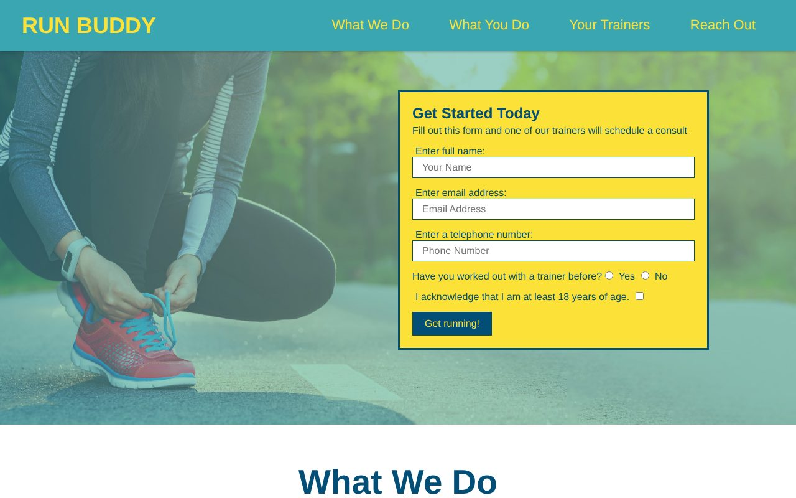

<h1 align="center">🏃 Run Buddy</h1>

<p align="center">A responsive landing page for Run Buddy, a fictional personal running-coach service.</p>

<p align="center">
  
  
</p>

<p align="center"></p>

## Features

- Sticky header with links to each section of the page
- Hero section with a "Get Started Today" sign-up form
- **What We Do**: an overview of the service
- **What You Do**: a 4-step guide to getting started
- **Meet the Trainers**: profiles for three trainers
- **Reach Out**: contact info
- A separate privacy policy page (`privacy-policy.html`)

## Built With

- HTML5
- CSS3 (no frameworks)

## Running Locally

No build step is needed.

1. Clone the repo:
   ```bash
   git clone https://github.com/ChristianKrantz11/run-buddy.git
   ```
2. Open `index.html` in your browser.

## Project Structure

```
├── index.html
├── privacy-policy.html
└── assets/
    ├── css/
    │   ├── style.css
    │   └── secondary-styles.css
    └── images/
```

## Author

[ChristianKrantz11](https://github.com/ChristianKrantz11)
